# MealCheck Fullstack

## Change Summary

- **2026-10-13:** Expanded the bundled knowledge guide to 100 curated topics; improved journal pagination, cache invalidation, assistant cancellation, report history, and query/service organization.
- **2026-10-11:** Added meal times and types, manual records, recording goals, action plans, coverage statistics, streaming assistant replies, and optional nutrition estimates; fixed legacy account-deletion constraints.
- **2026-10-04:** Added shared AI deadlines, retries and budgets, cursor-based conversation history, aggregate trend queries, resumable long-term memory rebuilds, and capacity/recovery tooling.
- **2026-10-02:** Added separate user/admin workspaces, asynchronous image analysis, recognition corrections, durable weekly-report workflows, evaluation tools, and operational safeguards.

The technical descriptions below cover source and configuration uploaded to this repository. Deployment and verification procedures are documented in [Release Baseline](deploy/RELEASE_BASELINE.md), [Optimization Verification](deploy/OPTIMIZATION_VERIFICATION.md), and [Operations and Evaluation](deploy/OPERATIONS_AND_EVALUATION.md).

MealCheck is a meal image analysis system. Users can upload meal photos, get food recognition results, receive nutrition scores, and view RAG-based dietary suggestions. In addition, users can interact with an AI assistant powered by LangChain4j and RAG to receive personalized dietary advice. Administrators can manage users, meal records, and the RAG knowledge base.

## Tech Stack

- Backend: Spring Boot
- Frontend: React + Vite
- Database: PostgreSQL
- Query optimization: [Field projection, cursor pagination, join indexes, and monitoring](deploy/QUERY_OPTIMIZATION.md)
- Vector Search: pgvector
- Cache & Session: Redis
- Image analysis messaging: RabbitMQ + PostgreSQL transactional outbox
- Authentication: JWT
- AI Vision: Qwen VL API
- AI Assistant: LangChain4j + RAG + optional Function Calling
- Weekly Report Multi-Agent: LangGraph4j orchestration + LangChain4j agents
- Knowledge Base: Markdown + pgvector Retrieval
- Agent Workflow: Tool orchestration, conversation memory, proactive suggestions
- Agent Skills: independently registered and dynamically selected diet skills
- MCP: authenticated Streamable HTTP tools for external AI clients
- Deployment: Docker Compose

## Features

- User registration, login, and JWT authentication
- Meal image upload and food recognition
- Meal structure scoring and risk tag analysis
- Optional per-meal portion entry and rough nutrition estimates (disabled by default). Users supply weights and per-100g label/reference data; incomplete inputs never produce a whole-meal total. Estimates explicitly warn about inaccuracy and are kept separate from structure scores, trends, and reports. See [Optional nutrition estimates](deploy/OPTIONAL_NUTRITION.md).
- RAG-based nutrition advice
- AI Assistant: LangChain4j + RAG
  - Provides personalized diet Q&A based on user meal history and nutrition knowledge
  - Supports conversation context, RAG references, and structured responses
  - Generates proactive suggestions based on recent diet trends
  - Dynamically selects a registered skill for weekly reports, trend analysis, fat loss, muscle gain, fried food, barbecue, vegetables, sweet drinks, or balanced diet advice
  - Uses layered memory with full PostgreSQL history, conversation-scoped Redis working memory, rolling summaries, structured state, and token-budgeted relevant history
  - Optionally lets the model select read-only local tools through LangChain4j Function Calling, with bounded rounds, an allow-list, a request deadline, and deterministic fallback
- MCP server
  - Exposes read-only dietary knowledge, Skill routing, recent meal, and weekly report tools at `/mcp`
  - Reuses the existing JWT authentication and records per-tool request count, outcome, and latency
- Meal history and weekly reports
  - Uses a LangGraph4j workflow for generated reports: trend Agent and RAG evidence run in parallel, then a diet-plan Agent produces the draft and a safety-review Agent approves or requests one revision.
  - Keeps database/RAG access as deterministic tool nodes instead of treating every service as an Agent.
  - Falls back to the original rule-based report when AI is unavailable, the graph fails, or the final review still rejects the draft.
  - Returns `generationMode`, `reviewStatus`, and `agentTrace` metadata with each generated report for debugging and demonstrations.
- Admin dashboard
  - User management
  - Global meal record pagination, filtering, deletion, and visual analytics
  - RAG knowledge creation, editing, deletion, search, rebuild, and hit statistics
  - AI assistant usage statistics, question trends, RAG reference ranking, and session analytics

## Meal Journal, Goals, Plans, and Report History

### Meal records and behavioral goals

1. Meal records include the actual eating time, breakfast/lunch/dinner/snack type, manual entry, backdated entry, and editing. Trends, filters, and reports use the actual eating date; creation time is stored separately. Historical and image-based records temporarily use creation time until their eating time is confirmed.
2. Behavioral goals support weekly recording days and daily distinct meal types, showing progress, remaining counts, and historical days that met the daily goal. Multiple records of the same meal type count once; records without a meal type do not count toward daily goals. Nutrition estimates remain disabled by default, explicitly warn about inaccuracy, and do not determine goal completion.
3. Meal suggestions, complete assistant answers, and weekly-report suggestions can be saved as plans. Plans support completion, skipping, reopening, and changes to content, dates, and notes, while retaining the suggestion source and report period.
4. Trends and reports include recording coverage, goal progress, and plan execution summaries. They distinguish "not recorded; status unknown" from an explicitly confirmed skipped meal, and identify insufficient samples and the actual statistical range.
5. The assistant supports SSE streaming, cancellation while waiting, answer feedback, question types, and request IDs. Incomplete answers are marked cancelled or abnormal in history and cannot be saved as plans as though they were complete answers.

Entry points, statistical definitions, APIs, concurrency controls, and migrations are described in [Meal Journal](deploy/MEAL_JOURNAL.md). Nginx disables API response buffering so SSE content reaches the client immediately. V28 adds fields and four business tables while retaining existing meals and historical reports.

### Cache, pagination, cancellation, and query behavior

1. Successful data mutations notify goals, plans, trends, and the current report through a shared mechanism, immediately invalidating related caches. Failed requests retain existing caches. Report-job completion also refreshes the history list.
2. Goals and plans return paginated results and totals, and the frontend supports page navigation. Goal edits query by ID and authenticated ownership directly, allowing older goals beyond the former 100-item limit to be edited; plan queries remain complete beyond 500 items.
3. Saving a manually entered plan clears the form for consecutive creation. The duplicate-prevention button remains active after saving the same suggestion.
4. Assistant deadlines include queue time. A request ID is available immediately during queuing, and queued requests can be cancelled. Cancelling a queued task releases queue capacity; a user can submit another request only after cleanup of a running task finishes.
5. Coverage and goal progress reuse one date/meal-type aggregation, with prefix counts for historical days that met the goal. Query counts do not increase with the number of goals.
6. Meal changes mark reports stale according to the affected dates while preserving historical report text. Plan, behavioral-goal, and note changes retain report text and update current progress in real time. Report history supports pagination and a read-only snapshot view; current reports no longer reuse snapshots from an older period.
7. The backend separates goal, plan, and statistics services from query repositories, uses independent DTOs, explicit interface types, constructor injection, and input validation, and keeps SQL out of controllers.

See [Code Optimizations](deploy/CODE_OPTIMIZATIONS.md) for APIs, statistics, caches, task states, and limits. External clients must parse paginated `content` from goal/plan GET responses instead of expecting arrays. V29 adds historical-report staleness fields, V30 adds failed-task references, and V31 adds query indexes; the V31 `.sql.conf` file enables non-transactional concurrent index creation. Assistant task registration is limited to one backend instance; multiple instances require routing or shared task state.

### Optional nutrition estimates and legacy account deletion

- Portion and nutrition estimates require user-entered weights and per-100g reference values. The UI explicitly states that estimates are inaccurate and for reference only. Incomplete inputs do not produce whole-meal totals, and estimates do not affect structure scoring or report judgments. See [Optional Nutrition](deploy/OPTIONAL_NUTRITION.md).
- Enabling estimates is disabled when a meal has no food items, with a prompt to correct recognition first. Existing invalid enabled settings can still be disabled and cleared.
- When incomplete information is saved, the UI shows "Food items with complete estimate data: X / Y" to help users fill gaps. Unknown values remain null, and the whole-meal total remains hidden.
- Legacy databases may retain Hibernate-created `NO ACTION` foreign keys alongside the V6 deletion constraints, blocking account deletion. V27 removes only duplicate restrictive constraints with the same table, columns, and referenced columns as the active V6 constraints; cascade constraints, audit nullification, other foreign keys, and business rows remain intact. The regression test upgrades to V5, introduces the legacy constraints, and then upgrades to V26 to reproduce constraint ordering. It verifies failure before V27, successful deletion afterward, cascading nutrition snapshots, and retained audit records.
- The [mobile verification script](deploy/scripts/verify_local_browser.mjs) uses the real frontend container and API to check default-off behavior, inaccuracy notices, saving, reopening, disabling/clearing, and the empty-food entry point. It does not intercept or mock the API; screenshots use synthetic data from disposable accounts.

## Curated Knowledge Source

The `v3-curated-100` source retains the original 26 topics and adds 74 independent entries covering staples and protein, vegetables and fruit, beverages and labels, eating-out budgets, food safety, and recording/review practices. Each entry includes public references; campus examples are application suggestions, not individual diagnoses or nutrition prescriptions.

The leading `<!-- mealcheck:independent-topics -->` marker preserves topic boundaries: short topics are not merged and unrelated overlap is not added between topics. An individual long topic still splits at the maximum token limit. At default settings, 100 topics produce 100 system knowledge chunks, with manually added administrator entries counted separately. Source synchronization replaces old system chunks while preserving `source=admin` entries. The detailed vector, chunk metadata, retrieval, and benchmark behavior is retained in Notes below.

## Workspace and Request Behavior

- User pages are separated into meal analysis, meal records, diet trends, weekly reports, and diet goals. Admin navigation groups business management, intelligent services, quality evaluation, and system management.
- Both interfaces share a workspace layout with a collapsible desktop sidebar, mobile drawer navigation, keyboard focus trapping, Escape-to-close, and focus restoration.
- Analysis results, meal records, and complete metrics open in detail drawers; trends and reports have separate pages. Long suggestions, complete food lists, and full report text remain accessible.
- Admin assistant evaluation is separated into current results, evaluation history, run comparison, and candidate samples. Monitoring and assistant statistics switch by category to avoid stacking all information on one page.
- Switching assistant conversations, filters, or admin pages cancels or ignores stale requests. HTTP status, error codes, request IDs, and `Retry-After` are retained consistently; expired authentication returns the user to login.

## Asynchronous Image Analysis and User Corrections

- RabbitMQ handles image analysis: tasks and outbox entries are persisted in the same transaction; publisher confirms and unroutable-message checks support redelivery. Consumers default to concurrency 8 per instance and prefetch 1, with at most 32 unfinished tasks globally. Messages are acknowledged after the result transaction commits. Dead-letter queues, execution-lease recovery, and duplicate-delivery isolation are supported. See [RabbitMQ Operations](deploy/RABBITMQ.md).
- `POST /api/meals/analysis-requests` accepts an image, a goal, and `Idempotency-Key`; a new task returns `202 / PENDING`. `GET /api/meals/analysis-requests/{key}` returns the authenticated user's progress and result. `/api/meals/analyze` remains available for synchronous clients.
- Images are decoded, dimension-checked, and normalized before entering the durable queue. Independent workers claim tasks; expired leases can be recovered, attempt tokens fence old executions, and queued images are removed after success.
- A request identifier is bound to the image and goal. Repeated submissions reuse the request; changed content returns a conflict. Successful results, meal records, and profile updates are published in one transaction to avoid duplicate meals. Crash recovery may still call the model again, so provider billing is not guaranteed to occur exactly once.
- The frontend polls task status with bounded retries after network failures. Refreshing preserves an unconfirmed request identifier and resumes polling. Failed requests can be retried with the original image, without creating another analysis merely because a response was lost.
- Users can correct food names, categories, and missed items. Corrections retain original recognition and revision history, validate ownership and record version, and recalculate scores and profiles.
- Scoring uses confident, deduplicated structured food categories only. Scene descriptions and notes do not directly affect scores. Historical records are not automatically rescored when rules change.

## Weekly Report Consistency and Agent Traces

- Reading and generating reports are separate: reads return a snapshot or rule-based summary, and only explicit background-job submission triggers generation. Refreshing the page does not repeat AI calls.
- Adding, deleting, or correcting meals invalidates old reports and related jobs. Invalidated jobs become `STALE`, allowing a fresh job for the same date. Snapshot publication and successful job completion share a transaction and validate the attempt number to prevent old attempts from overwriting new results.
- Report details load meals independently with pagination according to server-provided `periodStart` / `periodEnd`, unaffected by history-list pagination or filters. Food-item counts and counts of meals containing a category remain separate.
- The admin Agent Coordination view persists report runs and node records, displaying step state, duration, review revisions, and fallback behavior. Heartbeats, timeout recovery, and run-backlog metrics accompany this view.

## Assistant and Recognition Quality Evaluation

- Combined assistant evaluation contains **200 synthetic cases**, with quick 10-question, standard 50-question, and full 200-question modes covering intent routing, tool calls, and answer quality. Evaluation reuses the production Function Calling loop and tool definitions; users, meals, goals, and conversations use isolated synthetic data.
- Tool names, arguments, states, durations, rounds, and expected tool order are traceable. Missing required tools, invoking disabled tools, or violating trace constraints fails a case.
- Evaluation supports an independent judge model, quality dimensions and hard gates, Skill hit rate, and Macro-F1. Self-evaluation by the same model can receive at most `NEEDS_REVIEW`, never an automatic `PASSED`.
- Evaluation runs, per-case results, manual reviews, and anonymized failure candidates are persisted. Run comparison records the dataset version and SHA-256 fingerprint, warning when different modes or datasets cannot be compared directly. Approved candidates still require preparation and code review before entering the official evaluation set.
- Admin Recognition Correction Evaluation supports anonymization review, independently annotated expected scores, fixed regression-set export, historical runs, and failure comparison. Historical snapshots remain available even after the original meal is deleted.
- Independent image-recognition evaluation validates image-authorization declarations, human-annotation declarations, and SHA-256 hashes. It outputs precision/recall, category accuracy, per-case errors, P95, cost, and quality-gate results. **Scoring regression, synthetic assistant evaluation, and independent image-recognition evaluation measure different capabilities and cannot substitute for one another.**

Detailed definitions are in [Assistant Evaluation](backend/src/test/resources/evaluation/README.md), [Corrections and Reliability](deploy/RELIABILITY.md), and [Vision Evaluation Operations](deploy/OPERATIONS_AND_EVALUATION.md). These tools do not establish recognition accuracy on an independently annotated real-image dataset.

## Operations, Security, and Release Verification

- Production Compose, production configuration validation, non-root containers, health checks, and Nginx reverse-proxy configuration are provided. The frontend uses Docker DNS to resolve backend addresses dynamically, supporting access after backend container recreation.
- JWT validation checks immutable user ID, username, expiration, and account state. A deleted account's old token cannot authenticate a new account with the same username. Users can delete their own accounts after password verification, cleaning up associated data, images, and caches.
- Passwords are limited to 72 UTF-8 bytes. Concurrent registration with the same username returns 409. AI budget and timeout errors retain the appropriate status; error responses and shared health states use safe summaries. See [Password and Error Contract](backend/ERROR_CONTRACT.md).
- Metrics cover analysis failure rate, duration, queue backlog, tokens, and estimated cost. The initial monitoring configuration includes 15 alert rules with Prometheus, Alertmanager, and webhook notification configuration; budget and other extensions are detailed below.
- Database/image-consistent backup, rclone crypt encrypted copying, content verification, isolated restore drills, and systemd configuration for daily backups and weekly restore drills are provided.
- Retention policies cover failed images, failed requests, stale report jobs, and audit logs. Idempotency identifiers for successful requests are retained to prevent duplicate insertion after cleanup.
- CI defines backend unit/HTTP and real PostgreSQL integration tests, frontend tests and builds, Playwright browser acceptance, alert validation, production configuration smoke tests, and restore drills.

Published historical acceptance details are linked in [Optimization Verification](deploy/OPTIMIZATION_VERIFICATION.md). Test counts depend on the revision and must be taken from a fresh execution. Mixed load tests use model stubs and small datasets, so they do not establish real-provider capacity. Production notifications, remote storage, scheduled jobs, and release acceptance require the procedures in [Operations and Evaluation](deploy/OPERATIONS_AND_EVALUATION.md).

## Earlier Version Highlights

Compared with the previous project version, [MealCheck-agent2](https://github.com/Lan-lan-123/MealCheck-agent2), this version mainly improves the AI Assistant module and adds more detailed user-side and admin-side capabilities:

- Enhanced AI Assistant
  - Improved the LangChain4j + RAG based diet assistant with structured responses, reference display, conversation context, and personalized suggestions.
  - Added assistant usage statistics, RAG reference tracking, session analytics, and proactive diet advice.

- Improved user-side features
  - Added richer diet trend analysis, user goal/profile management, weekly report generation, and clearer upload feedback.
  - Added abnormal upload handling for non-food images, including user warnings and temporary upload restrictions.

- Enhanced admin dashboard
  - Added more detailed user, meal record, RAG knowledge base, assistant usage, abnormal upload, and system operation statistics.
  - Improved pagination, filtering, deletion confirmation, visual analytics, RAG evaluation, and AI observability panels.

## Backend Technical Details

### Shared AI deadlines, retries, and daily budgets

Image analysis and AI weekly reports primarily use asynchronous tasks, while synchronous compatibility endpoints remain available. Defaults are 120 seconds for backend AI operations, 150 seconds for the frontend container proxy, 165 seconds for the host proxy, and 180 seconds for long browser requests; ordinary queries, task submissions, and polling remain at 75 seconds. Raising the backend timeout requires corresponding changes in the other layers. See [Timeouts and Deployment](deploy/TIMEOUTS.md).

- Vision recognition, dietary suggestions, the ordinary assistant, Function Calling, weekly-report Agents, Embedding, Reranker, and evaluation judges share `AiHttpTransport`. LangChain4j reuses this entry point through an HTTP adapter, with SDK-internal retries disabled to avoid compounded retries. Tokens and estimated costs are collected centrally here.
- A single external call, including all retries and backoff, has a default total limit of 60 seconds. Single-meal analysis, assistant conversations, and weekly-report generation share a default 120-second operation deadline. Function Calling retains the shorter 30-second limit. Each HTTP request uses the remaining time as its timeout; executor queuing does not grant additional time, and cancellation prevents new attempts. Context is explicitly propagated through bounded executors and report graph nodes.
- Retries use exponential backoff with jitter and support provider `Retry-After` values expressed as seconds or HTTP dates. If the requested wait exceeds the remaining time, the operation ends immediately. Ordinary 4xx responses are not retried; 429, 5xx, and network failures can be retried within the budget.
- PostgreSQL atomically reserves call counts and estimated costs before each external attempt, sharing quotas across instances. Each user defaults to 100 **external attempts** per day; retries, function-calling rounds, and query embeddings each count separately. This is not 100 questions or image uploads. Background indexing and admin combined evaluation use an independent system quota of 5,000 attempts per day by default; combined evaluation resets the operation timeout for each case.
- Trusted usage with configured input/output prices matching the model and API is settled according to token usage. Other providers, missing usage, or failures with uncertain results are conservatively charged at the reserved amount. Unsent reservations are released. After process interruption, recovery reclaims reservations older than 10 minutes; attempts already marked sent retain call counts and estimated costs. Ledger entries are retained for 30 days and cascade-delete with the user account.
- Cost units follow the configured per-million-token prices, and monetary limits are disabled by default. Monetary budgets are **estimated quotas**: input is conservatively estimated from request length, and image Base64 may inflate reservations; actual provider billing, hidden tokens, or missing usage can differ. These budgets are not a hard cap on provider invoices.
- `GET /api/profile/ai-budget` returns only the authenticated user's daily call count, remaining quota, settled cost, reserved cost, and reset time. Exhaustion returns `429 / AI_BUDGET_EXCEEDED` with `Retry-After`; unavailable budget storage rejects new model calls with `503 / AI_BUDGET_UNAVAILABLE`. Direct-processing endpoint timeouts return `504 / AI_DEADLINE_EXCEEDED`; existing assistant, report, and reranking fallback paths may still return local results.

Common configuration settings are included in both environment examples and Compose:

| Environment variable | Default | Purpose |
| --- | --- | --- |
| `MEALCHECK_REMOTE_TOTAL_TIMEOUT_SECONDS` | `60` | Total limit for one external call, including retries |
| `MEALCHECK_AI_OPERATION_TIMEOUT_SECONDS` | `120` | Shared limit for one user AI operation |
| `MEALCHECK_AI_MAX_OUTPUT_TOKENS` | `2048` | Chat-model output limit |
| `MEALCHECK_AI_GLOBAL_DAILY_CALLS` | `100000` | Daily external-attempt limit shared by all users and system tasks |
| `MEALCHECK_AI_BUDGET_ENABLED` | `true` | Enable persistent budgets |
| `MEALCHECK_AI_DAILY_CALLS` | `100` | External-attempt limit per user per day |
| `MEALCHECK_AI_SYSTEM_DAILY_CALLS` | `5000` | Daily attempt limit for background work and combined evaluation |
| `MEALCHECK_AI_DAILY_COST` | `0` | Estimated monetary limit per user per day; 0 disables the monetary limit |
| `MEALCHECK_AI_SYSTEM_DAILY_COST` | `0` | Daily estimated monetary limit for system work; 0 disables the monetary limit |
| `MEALCHECK_AI_RESERVATION_COST` | `0.02` | Minimum reservation per attempt; unknown costs settle at the reserved amount |
| `MEALCHECK_AI_BUDGET_ZONE` | `Asia/Shanghai` | Timezone for daily quota resets |

Prices are configured through `MEALCHECK_AI_INPUT_COST_PER_MILLION` / `MEALCHECK_AI_OUTPUT_COST_PER_MILLION`. Both total timeouts accept 1–300 seconds; output limits accept 1–32,768 tokens. Invalid budget configuration prevents startup. Flyway **V21** creates the budget ledger and query indexes. Disabling budgets skips ledger limits only; deadlines, retries, and output limits remain active.

### Cursor pagination for long conversations

- `GET /api/assistant/conversations/{id}?limit=40` returns only the latest 40 messages by default, with `limit` from 1–100. Messages within a page are displayed in ascending time/ID order; the response includes `hasMore` and `nextBefore`.
- When earlier pages exist, pass the returned `nextBefore` as the next request's `before` parameter. The cursor is bound to the conversation and uses `(createdAt,id)` as its boundary. Equal timestamps and newly inserted messages during pagination do not cause duplicate or missing pages. Each read fetches at most `limit+1` rows, without loading the full history or counting all pages. Cursors cannot be reused across conversations; every query still validates authenticated ownership.
- The chat page offers "Load earlier messages" and preserves scroll position after prepending history. Creating or switching conversations cancels old history requests and ignores late responses. Model memory uses a separate bounded window and summaries, independent of the amount of history loaded by the page.
- The original detail URL remains, but `messages` now means the **current page**. Other clients must use the pagination fields to retrieve older messages.

### Aggregate trend queries and field projection

- PostgreSQL aggregates meal counts, average scores, high/low-score counts, first/last scores, and daily averages. Food and risk statistics read only their two JSON fields, without loading full `MealRecord` entities, long suggestions, original recognition results, or user entities.
- The 7–90-day range, score thresholds, rounding, and existing response fields are retained. Three queries run in the same read-only database snapshot to keep counts and charts consistent during concurrent meal insertion. Daily statistics convert underlying UTC timestamps back to the server timezone to preserve the original entity-read date definitions; equal timestamps use ID ordering for stable first/last scores. Filters always restrict results to the authenticated user.
- V21 adds user/time/ID and conversation/time/ID indexes. Queries remain live, without a daily-summary table. Integration tests save `EXPLAIN (ANALYZE,BUFFERS)` comparisons for 2,000 isolated records with long suggestions to `backend/target/trend-query-plans.txt`. Small-sample SQL timing differences do not establish production performance; the primary benefit is reduced returned data and Java entity loading. Whether to add summaries depends on actual production slow queries and load.

### Long-term assistant memory migrations and resumable rebuilds

- Flyway **V22** manages long-term memory structure. Original text and vectors for different versions are stored separately. Upgrading existing `vector` / `halfvec` tables preserves text, record IDs, and old vectors. Application startup no longer performs dynamic DDL, clears memory, or synchronously calls models for this memory structure.
- Changes to the embedding model, dimension, or storage precision create persistent background rebuild jobs, processing five entries per batch. Jobs use a three-minute lease and execution token, allowing another instance to take over expired work. Completed vectors whose source-text hash still matches are reused. After five cumulative execution failures, the job pauses; administrators can fix configuration or dependencies and retry.
- Once all current memory is ready, the active version switches atomically within a database transaction. During rebuilds, version mismatches, or query-embedding failures, the assistant falls back to a bounded set of the current user's recent original text. New memories store original text first, so failed vector calls do not lose it.
- Admin endpoints: `POST /api/admin/assistant-memory/rebuilds` starts or reuses a job; `GET /api/admin/assistant-memory/rebuilds/{id}` reads progress; `POST /api/admin/assistant-memory/rebuilds/{id}/retry` retries it. Responses contain job metadata only, never user memory text. Multiple instances should use the same model, dimension, and precision configuration; rebuilds targeting different versions cannot start simultaneously.
- PostgreSQL integration tests cover actual upgrades of legacy `halfvec(3)` tables, dimension/model/precision changes, checkpoint recovery, expired execution tokens, new memory preventing premature activation, activation rollback, and user isolation.

### User quota displays, admin monitoring, and alerts

- Upload and assistant pages show remaining external-call counts and reset time, update after operations, and support manual refresh. When monetary limits are enabled, used and reserved estimated costs are also displayed. The UI states that one operation may make multiple calls and retries consume quota; final admission remains controlled by atomic backend reservation.
- Failed asynchronous image tasks expose a permitted public `errorCode`: exhausted quota asks the user to wait for reset, while unavailable budget storage asks for a later retry. Internal exceptions are not sent directly to users; quota errors do not clear login sessions.
- Admin AI monitoring includes budget cards. `GET /api/admin/ai-budget` returns budget enablement, recovery-monitor health, unsettled/expired reservations, the age of the oldest reservation in seconds, and rejection/delayed-settlement/storage-failure counts. Reservation statistics come from the shared database; cumulative counters belong to the current instance and should be aggregated across instances in Prometheus.
- Five budget alerts cover unusual rejection counts, settlement delays, expired reservation backlog, failed recovery monitoring, and unavailable budget storage. Disabling budgets avoids false monitoring-health alerts. The corresponding rule set contains 25 rules and can be checked with `promtool`. Thresholds should reflect actual call volume; notification receivers use the deployment monitoring configuration.

### Large datasets, image resources, and dependency recovery checks

- The separate [capacity acceptance environment](deploy/compose.acceptance.yml) and [acceptance script](loadtests/capacity_acceptance.py) use only a fixed isolated local Compose project, dedicated accounts, and model stubs. Project labels and stub configuration are verified before data writes or dependency interruption. Full commands are in the [load-testing guide](loadtests/README.md). CI defines execution, cleanup, and evidence archiving; remote CI results must be taken from actual run records.
- Defaults prepare five accounts, 50,000 meals with long suggestions, 10,000 chat messages, and 4096×4096 images. Checks cover trend queries, two consecutive history pages, normal uploads, slow models, recovery after 429 responses, saturated decode concurrency, and access recovery with the original JWT after Redis/PostgreSQL interruption.
- Collection includes k6 success/failure/rejection/timeout counts, CPU, container memory, JVM heap, connection-pool acquisition time, queue-wait histograms, HTTP retries, and estimated costs, plus actual trend SQL `EXPLAIN (ANALYZE,BUFFERS)` output. Connection acquisition time is not SQL execution time; queue P95 is a histogram bucket upper bound, and resource peaks come from sampling.
- Temporary 429 responses followed by recovery are tested separately from sustained periodic 429 responses that can exhaust finite retries. Accepted-task success, entrance rejection, execution failure, timeout, and uncertain results are recorded independently. Both dependency outages are expected to return 503, with the original JWT usable after recovery.
- Query cold-start latency and sampled container-memory peaks are recorded as capacity boundaries. Short synthetic runs and model stubs do not establish maximum production capacity, sustained stability, or real recognition quality; production resource sizing requires sustained-load verification.

### Scheduler, proxy, and task reliability

Six related optimizations are detailed in [Backend Reliability and Resource Isolation](deploy/BACKEND_OPTIMIZATIONS.md):

- Background schedulers are separated from assistant timer threads; expensive maintenance uses bounded pools, and duplicate unfinished work of the same type is coalesced.
- Both Nginx layers clear and reconstruct forwarding headers and trust only explicit proxy addresses. Real proxy-chain and forged-header regression tests are provided.
- Upload admission limiting and idempotency checks occur before image decoding. Repeated requests skip decoding; by default, at most two images decode concurrently.
- Weekly-report claims match executor capacity. Scheduling rejection returns the attempt count, delays execution, and rotates the token to prevent old attempts from updating the job.
- Invalid JWTs return 401; Redis/database authentication dependency failures return 503 with metrics, preventing frontend session removal.
- Flyway V20 manages the fixed knowledge schema. Vector rebuilds persist batch progress, support recovery and admin retry, and activate atomically after completion.

Verification: run `mvn verify -Pintegration` for the backend with Docker available; run `npm test`, `npm run build`, and `npx playwright test e2e/assistant-history.spec.js` for the frontend. Real HTTP tests cover total deadlines, `Retry-After`, shared SDK transport, and budget rejection. PostgreSQL tests cover concurrent quotas, idempotent settlement, crash recovery, cursor boundaries, and trend date definitions.

## Local Deployment, Upgrade, and Recovery Procedures

The [local Compose overlay](deploy/compose.local.yml) binds ports to `127.0.0.1` and requires Compose 2.24.4+ for `!override`. Database, cache, and messaging development settings are intended for local use. Keep `.env` untracked; the business timezone is `Asia/Shanghai` and timestamps are stored in `UTC`. Configure `MEALCHECK_LOCAL_BACKEND_IMAGE` and `MEALCHECK_LOCAL_FRONTEND_IMAGE` with distinct image tags for the intended version.

Run from the repository root:

```powershell
# Build a new version using distinct image tags configured in .env.
docker compose --env-file .env -p mealcheck-fullstack -f docker-compose.yml -f deploy/compose.local.yml --profile fullstack build backend frontend

# Start the backend first and wait for dependencies and migrations.
docker compose --env-file .env -p mealcheck-fullstack -f docker-compose.yml -f deploy/compose.local.yml --profile fullstack up -d --no-build --wait --wait-timeout 120 backend

# Start the frontend.
docker compose --env-file .env -p mealcheck-fullstack -f docker-compose.yml -f deploy/compose.local.yml --profile fullstack up -d --no-build --wait --wait-timeout 60 frontend

# Inspect status and backend logs.
docker compose --env-file .env -p mealcheck-fullstack -f docker-compose.yml -f deploy/compose.local.yml --profile fullstack ps
docker compose --env-file .env -p mealcheck-fullstack -f docker-compose.yml -f deploy/compose.local.yml logs --tail 100 backend
```

Before an upgrade, back up data, build and record distinct new image tags, verify content IDs, and then start services. Do not overwrite verified tags. Keep the project name unchanged to reuse existing volumes, and do not use `down -v` to delete persistent data.

Python 3.11+, Node/npm, installed frontend dependencies, and Docker are required for deployment verification and recovery. Use new output directories for every run; scripts refuse to overwrite existing verification and backup directories. Backup and verification output can contain private data and stays Git-ignored.

```powershell
# Consistent pre-upgrade database and image backup, followed by an isolated restore drill.
python deploy/scripts/recovery.py backup --project mealcheck-fullstack --env-file .env --compose docker-compose.yml --compose deploy/compose.local.yml --output deploy/recovery-results/your-upgrade/pre-deployment
python deploy/scripts/recovery.py drill --backup deploy/recovery-results/your-upgrade/pre-deployment --output deploy/recovery-results/your-upgrade/pre-deployment-restored

# Choose new image tags and update the two MEALCHECK_LOCAL_*_IMAGE values in .env.
docker build -t mealcheck-local-backend:your-new-version -f backend/Dockerfile backend
docker build -t mealcheck-local-frontend:your-new-version -f frontend/Dockerfile frontend
docker compose -p mealcheck-fullstack --env-file .env -f docker-compose.yml -f deploy/compose.local.yml up -d --no-build --wait --wait-timeout 180 backend frontend

# Real HTTP and 390px mobile-page verification with disposable accounts and meals.
$env:PLAYWRIGHT_CHROMIUM_EXECUTABLE='C:\Program Files\Google\Chrome\Application\chrome.exe'
python deploy/scripts/verify_local_deployment.py --browser --output deploy/release-results/my-next-check

# Consistent backup briefly stops backend writes and resumes them afterward.
# Stop external writers as well.
python deploy/scripts/recovery.py backup --project mealcheck-fullstack --env-file .env --compose docker-compose.yml --compose deploy/compose.local.yml --output deploy/recovery-results/my-next-backup

# Restore into new containers without public ports; verify table counts, image references, and file hashes.
python deploy/scripts/recovery.py drill --backup deploy/recovery-results/my-next-backup --output deploy/recovery-results/my-next-restore

# Verify the curated RAG source locally without real embedding or reranking keys.
python deploy/scripts/verify_rag_knowledge.py --output deploy/release-results/your-rag-verification
```

Flyway runs automatically at backend startup. V23–V27 cover global AI admission, persistent assistant evaluation tasks, image references and weekly-report dispatch, optional nutrition snapshots, and legacy duplicate foreign-key cleanup. If migration fails, inspect logs rather than deleting migration history. Reusing an old image with an upgraded database is not a complete rollback; restore a consistent pre-upgrade database and image backup when data rollback is required. Preserved images alone do not establish compatibility with the new database.

Deployment verification checks Nginx pages and assets, Redis CAPTCHA, registration and authentication, database/cache/upload-directory health, budget reads, admin API isolation, image reads, default-off estimates, portion-only saves without totals, negative-value rejection, source validation, complete conversion, explicit zeros, version conflicts, estimate invalidation after real corrections, and account-deletion cleanup. Disposable data is cleaned up automatically; synthetic foods and nutrition values do not represent model quality or real food data. The deployment verifier checks that real AI keys are absent before invoking local assistant fallback, preventing model charges.

Image recognition requires real provider configuration. Set `MEALCHECK_AI_API_KEY` and `MEALCHECK_AI_BASE_URL` in the local `.env`, recreate the backend container, and verify real model quality and cost separately. Hash embeddings and local rule-based assistant replies do not constitute real-model acceptance.

## Project Structure

```text
mealcheck-fullstack/
  backend/              Spring Boot backend
  frontend/             React + Vite frontend
    e2e/                Playwright browser acceptance tests
    test/               Request consistency and async polling tests
  deploy/               Production, monitoring, backup and verification guides
  tools/                Vision evaluation, comparison and operations checks
  loadtests/            k6 load tests and mixed workload scenarios
  .github/workflows/    CI build, tests, smoke checks and restore drills
  docker-compose.yml    PostgreSQL + Redis + optional full-stack services
  docker-compose.prod.yml    Production application stack
  docker-compose.mirror.yml  Optional Maven mirror for Docker builds
  .env.example          Environment variable example
  .env.production.example   Production environment example
```

## Quick Start

Prerequisites: JDK 17, Maven, Node.js 22 (as used in CI), and Docker Compose for PostgreSQL/Redis/RabbitMQ and integration tests. Configure the AI provider before testing image recognition; no API key is bundled.

Use [.env.example](.env.example) as the configuration reference. Docker Compose reads `.env` values referenced by its service definitions. A backend launched with Maven needs the variables in its process environment or IDE run configuration; it does not automatically load the root `.env` file. Production configuration uses [.env.production.example](.env.production.example).

### 1. Start only infrastructure services for local development

```bash
docker compose up -d
```

This starts only:

- PostgreSQL + pgvector
- Redis
- RabbitMQ (AMQP on `127.0.0.1:5672`; development management UI on `http://localhost:15672`)

### 2. Start the backend

```bash
cd backend
mvn spring-boot:run
```

Default backend URL:

```text
http://localhost:8080
```

### 3. Start the frontend

```bash
cd frontend
npm ci
npm run dev
```

Default frontend URL:

```text
http://localhost:5173
```

### Optional: start the whole stack with Docker

```bash
docker compose --profile fullstack up --build -d
```

This starts PostgreSQL, Redis, RabbitMQ, backend, and frontend together.

If Docker Hub times out while fetching the frontend's Nginx image, fetch the
same image tag through the DaoCloud proxy and add the local tag expected by the
Dockerfile:

```bash
docker pull m.daocloud.io/docker.io/nginxinc/nginx-unprivileged:1.27-alpine
docker tag m.daocloud.io/docker.io/nginxinc/nginx-unprivileged:1.27-alpine nginxinc/nginx-unprivileged:1.27-alpine
```

If Maven Central also fails with a TLS handshake error during the backend build,
use the optional build-only Aliyun Maven mirror override:

```bash
docker compose -f docker-compose.yml -f docker-compose.mirror.yml --profile fullstack up --build -d
```

The regular Docker build still defaults to Maven Central. BuildKit caches Maven
dependencies between builds. Neither workaround changes global Docker proxy or
Maven settings. Verify startup with `docker compose --profile fullstack ps`, then
open `http://localhost:5173`; the backend API is exposed at
`http://localhost:8080`. Registry proxy syntax is documented by
[DaoCloud](https://github.com/DaoCloud/public-image-mirror), and the Maven mirror
is documented by [Aliyun](https://developer.aliyun.com/mirror/maven).

For an ECS production deployment, use `docker-compose.prod.yml` and follow
[`deploy/PRODUCTION.md`](deploy/PRODUCTION.md). The production stack binds the
web container to loopback only and expects the host Nginx or an Alibaba Cloud
load balancer to terminate HTTPS.

## Environment Variables

The following is a subset of the available settings. See [.env.example](.env.example) for assistant evaluation judge, worker and concurrency settings, [application.yml](backend/src/main/resources/application.yml) for analysis queue and retention defaults, and [deploy/operations.env.example](deploy/operations.env.example) for monitoring and encrypted backup configuration. When adding a setting to a Compose deployment, also ensure it is passed into the backend container.

```text
SPRING_DATASOURCE_URL=jdbc:postgresql://localhost:5432/mealcheck
SPRING_DATASOURCE_USERNAME=mealcheck
SPRING_DATASOURCE_PASSWORD=mealcheck123
MEALCHECK_AI_API_KEY=your_api_key
MEALCHECK_AI_BASE_URL=https://example.com/compatible-mode/v1/chat/completions
MEALCHECK_AI_MODEL=qwen3-vl
MEALCHECK_KNOWLEDGE_EMBEDDING_API_KEY=your_embedding_api_key
MEALCHECK_KNOWLEDGE_EMBEDDING_BASE_URL=https://example.com/compatible-mode/v1
MEALCHECK_KNOWLEDGE_EMBEDDING_MODEL=text-embedding-v4
MEALCHECK_KNOWLEDGE_EMBEDDING_DIM=512
MEALCHECK_KNOWLEDGE_VECTOR_STORAGE=halfvec
MEALCHECK_KNOWLEDGE_RERANK_ENABLED=false
MEALCHECK_KNOWLEDGE_RERANK_URL=https://api.jina.ai/v1/rerank
MEALCHECK_KNOWLEDGE_RERANK_API_KEY=your_rerank_api_key
MEALCHECK_KNOWLEDGE_RERANK_MODEL=jina-reranker-v2-base-multilingual
MEALCHECK_KNOWLEDGE_RERANK_CANDIDATE_MULTIPLIER=4
MEALCHECK_KNOWLEDGE_RERANK_MODEL_WEIGHT=0.75
MEALCHECK_KNOWLEDGE_RERANKER_MIN_SCORE=0.20
MEALCHECK_KNOWLEDGE_RRF_K=60
MEALCHECK_KNOWLEDGE_RESULT_FILTER_ENABLED=true
MEALCHECK_KNOWLEDGE_RESULT_MIN_SCORE=0.35
MEALCHECK_KNOWLEDGE_RESULT_RELATIVE_SCORE=0.60
MEALCHECK_KNOWLEDGE_RESULT_DEDUP_SIMILARITY=0.88
MEALCHECK_KNOWLEDGE_RESULT_CANDIDATE_MULTIPLIER=4
MEALCHECK_KNOWLEDGE_CHUNK_MIN_TOKENS=300
MEALCHECK_KNOWLEDGE_CHUNK_MAX_TOKENS=500
MEALCHECK_KNOWLEDGE_CHUNK_OVERLAP_TOKENS=50
MEALCHECK_KNOWLEDGE_SPLITTER_STRATEGY=recursive-markdown
MEALCHECK_KNOWLEDGE_SOURCE_VERSION=v3-curated-100
MEALCHECK_MCP_ENABLED=true
MEALCHECK_MCP_ENDPOINT=/mcp
MEALCHECK_ASSISTANT_FUNCTION_CALLING_ENABLED=false
MEALCHECK_ASSISTANT_FUNCTION_CALLING_MAX_TOOL_ROUNDS=3
MEALCHECK_ASSISTANT_FUNCTION_CALLING_MAX_TOOL_CALLS=6
MEALCHECK_ASSISTANT_FUNCTION_CALLING_TOTAL_TIMEOUT_SECONDS=30
MEALCHECK_ASSISTANT_MEMORY_HISTORY_TOKEN_BUDGET=1200
MEALCHECK_ASSISTANT_MEMORY_RECENT_MESSAGES=6
MEALCHECK_ASSISTANT_MEMORY_SUMMARY_MAX_TOKENS=500
MEALCHECK_ASSISTANT_MEMORY_RELEVANT_MESSAGES=4
```

## Notes

### Reliability, corrections and release verification

See [`deploy/RELIABILITY.md`](deploy/RELIABILITY.md) for meal-analysis idempotency and result recovery, user recognition corrections, reviewed scoring regression datasets, browser acceptance tests, production smoke checks, and consistent database/image backup-and-restore drills. Migration V16 invalidates old weekly reports after meal changes; repeated generation creates a fresh job when the previous report is stale.

### Report generation and verification

- `GET /api/reports/weekly?days=7` reads a stored report or a rule-based summary; it never calls an AI model.
- `POST /api/reports/weekly/jobs?days=7` submits a durable job and returns `202` with its ID and status (or `200` for a terminal cached job). `GET /api/reports/weekly/jobs/{id}` reads the authenticated user's job and completed report.
- Submissions reuse the same non-stale user/date/day-count job, including failed jobs. Meal changes invalidate the old job as `STALE`, allowing a fresh job for the same period. New jobs have a configurable token bucket (default capacity 3, refill 1 per hour). The dashboard submits and polls these jobs; refreshing a page never launches AI generation.
- `categoryTotals` counts food items; `categoryMealCounts` counts meals containing each category. Report periods use inclusive calendar dates; retries retain the original job creation date as the period end.
- Snapshot publication and successful job completion share one transaction, fenced by the attempt number. Migration V15 gives every new snapshot a unique job ID. Legacy snapshots remain readable.
- Run `mvn test` for backend unit/HTTP tests and `npm test` in `frontend` for report polling tests. Run `mvn verify -Pintegration` with Docker running for mandatory PostgreSQL migration, transaction, and concurrency tests. CI runs this full profile and fails when Docker is unavailable; database tests are not silently skipped.
- JWT authentication requires an existing immutable user ID, matching username, valid expiration, and an active account. Tokens for deleted accounts cannot authenticate a new account with the same username.
- Scoring uses confident, deduplicated food entries and structured categories. Scene summaries and notes cannot directly change the score. These rule changes apply to new analyses; historical meal scores are not automatically rewritten.

- Image recognition requires a configured AI provider; missing configuration returns an explicit error without saving a fabricated recognition result.
- The default RAG source is `backend/src/main/resources/knowledge/diet_guides.md`.
- Configure an OpenAI-compatible embedding endpoint for semantic retrieval. Without it, the system remains available through a local 512-dimensional hash embedding fallback.
- Existing fixed-dimension knowledge vectors are migrated to the configured dimension at startup and regenerated with the active embedding provider.
- Knowledge embeddings use pgvector `halfvec` storage by default. For 512 dimensions this reduces the raw vector payload from 2,056 bytes to 1,032 bytes (about 49.8%); set `MEALCHECK_KNOWLEDGE_VECTOR_STORAGE=vector` to keep 32-bit vectors.
- A same-dimension migration from `vector` to `halfvec` casts existing values without calling the embedding API again. A dimension change still regenerates embeddings to preserve correctness.
- Each knowledge vector stores an embedding signature. Switching between the hash fallback and a semantic model automatically refreshes stale vectors instead of mixing embedding spaces.
- The bundled guide contains **100 independently curated topics** (`v3-curated-100`), each with a public reference and practical campus examples. Its leading `<!-- mealcheck:independent-topics -->` marker preserves heading boundaries: short topics are neither merged nor prefixed with unrelated topics. At default settings the guide produces exactly 100 database chunks, each title plus body embedded as one vector. Long individual topics still split at the configured maximum with internal overlap.
- For ordinary Markdown without the marker, `recursive-markdown` still uses heading, paragraph, line, sentence and token-window boundaries, approximately 300–500 tokens and 50-token overlap; `legacy-window` remains available. Curated short topics may be under 300 tokens.
- Admin counts database chunks rather than evaluation questions: the separate assistant evaluation set has 200 cases (50 base + 150 expansion). Rebuilding the backend and synchronizing the knowledge source updates the 100 system entries while preserving `source=admin` entries. A configured source version in `.env` overrides the new default; set `MEALCHECK_KNOWLEDGE_SOURCE_VERSION=v3-curated-100` to label this corpus correctly.
- References provide general food principles; campus menus and recordkeeping examples are editorial applications, not medical prescriptions or measured nutrition data. Real model answer quality remains a separate verification task.
- Each chunk stores its source, category, source version, token count, update timestamps, stable chunk key, and SHA-256 content hash. Reindexing only regenerates vectors for new or changed chunks; unchanged chunks keep their existing vectors and hit statistics.
- RAG entries manually added by administrators are stored in the database and preserved separately.
- Hybrid retrieval independently ranks pgvector, title pg_trgm, and content pg_trgm candidates, then combines their ranks with weighted Reciprocal Rank Fusion (`k=60`) plus a small category prior. The normalized fusion score remains compatible with confidence metrics.
- Optional second-stage reranking expands Top-K weighted-RRF candidates by four and calls a query-document relevance model. Rough rank and reranker rank are fused with Weighted RRF; rough score/rank, raw reranker score/rank, and final score are retained separately. A timeout or provider failure automatically keeps the rough ranking.
- The 58-case admin RAG benchmark contains 48 answerable and 10 no-answer questions. It reports Hit@3, Hit@5, MRR, nDCG@5, category accuracy, no-answer accuracy, false-positive rate, layered scores, per-stage latency, and an automatic regression result.
- When reranking is active, candidates below `MEALCHECK_KNOWLEDGE_RERANKER_MIN_SCORE` are rejected before context injection; this raw-score threshold must be calibrated against the no-answer benchmark for the selected provider.
- Final RAG results use a configurable absolute score floor plus a relative-to-Top1 floor, then remove near-duplicate chunks with lexical Jaccard similarity before context injection.
- Assistant history remains intact in PostgreSQL. Redis keys include both username and conversation ID, preventing working-memory leakage between separate conversations.
- Normal assistant requests load a bounded recent PostgreSQL window and incrementally summarize at most 100 pending older messages, avoiding a full-history scan as conversations grow.
- Prompt memory is selected by token budget rather than a fixed message count: the most recent messages are retained, relevant older messages are selected, and evicted history is compressed into a rolling summary. Follow-up questions are expanded with the active conversation topic before RAG retrieval.
- Explicit user goals, preferences, allergies, and restrictions are stored as deduplicated long-term memory vectors. Recall combines semantic similarity, 90-day recency decay, and a same-conversation boost before facts enter the prompt.
- Recent meals, current goal, weekly report, RAG, and long-term memory are fetched concurrently with independent timeouts and graceful per-source fallback. DB, RAG, and background writes use separate fixed-size bounded executors; a request-wide deadline actively cancels timed-out tasks. Proactive advice reuses the already loaded meal records.
- Function Calling is disabled by default. When enabled, the model can select only four read-only tools: dietary knowledge search, recent meals, latest weekly report, and current goal. Model HTTP calls, DB tools, and RAG tools run in separate bounded pools; tool rounds, total tool calls, arguments, result sizes, and the end-to-end deadline are bounded. Any failure returns to the existing deterministic orchestration path.
- RAG and admin-stat caches use jittered TTLs and single-flight refresh. Empty RAG results receive a shorter TTL, while a stale copy lets concurrent followers avoid stampeding the database or model provider during refresh.
- Weekly report generation reuses the durable database job/worker boundary. LangGraph4j manages the internal parallel branches and review loop, while LangChain4j performs the three role-specific model calls. The review loop is bounded by `MEALCHECK_WEEKLY_REPORT_MAX_REVIEW_REVISIONS`, and each Agent call has an independent `MEALCHECK_WEEKLY_REPORT_AGENT_TIMEOUT_SECONDS` timeout.
- Remote AI, embedding, and reranker calls use configurable exponential-backoff retry, circuit breaking, and semaphore concurrency isolation in addition to HTTP timeouts.
- Flyway owns the versioned relational schema and query indexes; Hibernate uses `ddl-auto=validate` instead of mutating production tables at startup. Runtime-configured pgvector/halfvec columns remain managed by their vector services.

## Observability

Spring Boot Actuator exposes health and application metrics:

```text
GET /actuator/health
GET /actuator/metrics
GET /actuator/prometheus
```

`health` is public, while `metrics` and `prometheus` require authentication. Responses include an `X-Request-ID`, and the same request ID is included in backend logs for correlation.

The production profile exposes only health and Prometheus endpoints. The monitoring Compose overlay uses an internal management port (`9091`) without a host mapping; see [operations instructions](deploy/OPERATIONS_AND_EVALUATION.md) for network access and alert setup.

Custom metrics include:

- `mealcheck.knowledge.embedding.*`: embedding request count and latency by provider/outcome
- `mealcheck.knowledge.index.*`: incremental indexing duration, runs, and inserted/updated/unchanged/deleted chunk counts
- `mealcheck.rag.search.*`: RAG cache hit/miss, latency, result count, and top score
- `mealcheck.rag.filter.*`: candidate/output counts, threshold removals, duplicate removals, effective threshold, and empty-result rate
- `mealcheck.rag.score.*`: rough Top1, raw reranker Top1, final Top1, and whether reranking was applied
- `mealcheck.rate.limit.requests`: Redis token-bucket decisions by API scope and outcome
- `mealcheck.executor.*`: executor pool/queue saturation, rejection count, queue wait, and task duration
- `mealcheck.weekly.report.jobs`: durable weekly-report job success, failure, rejection, and stale-result count
- `mealcheck.weekly.report.coordination.*`: workflow and node outcomes, duration, review revisions, recoveries, active runs, and oldest active age
- `mealcheck.analysis.*`: pending analysis tasks, oldest active age, and expired leases
- `mealcheck.ai.tokens`, `mealcheck.ai.estimated.cost`, `mealcheck.ai.usage.missing`, `mealcheck.ai.cost.unpriced`: model usage, estimated cost, and missing usage/pricing signals
- `mealcheck.rag.rerank.*`: reranker request count, outcome, latency, and candidate count
- `mealcheck.ai.call.*`: VLM/assistant API request count and latency by operation/outcome
- `mealcheck.weekly.report.generated`: weekly report success/failure count
- `mealcheck.mcp.tool.*`: MCP tool request count and latency by tool/outcome
- `mealcheck.assistant.memory.*`: selected message/token counts, summary updates, and follow-up rewrite counts
- `mealcheck.assistant.tool.*`: latency and outcome for each parallel assistant data source and long-term memory write

## MCP Tools

The MCP Streamable HTTP endpoint is `POST /mcp`. Send the same `Authorization: Bearer <JWT>` header used by the REST API. User-specific tools derive the user identity from that JWT; no `userId` argument is accepted.

- `search_diet_knowledge`: hybrid dietary knowledge retrieval
- `route_assistant_skill`: select a registered assistant Skill
- `list_assistant_skills`: list available Skills
- `get_my_recent_meals`: get the authenticated user's recent meals
- `get_my_weekly_report`: get the authenticated user's latest weekly report

For a real initialize/list/call demonstration with a disposable account, see
[`deploy/MCP_DEMO.md`](deploy/MCP_DEMO.md). The Python client handles MCP sessions,
prints a summary, and can save a JWT-free request/response transcript.

## Function Calling and MCP

Set `MEALCHECK_ASSISTANT_FUNCTION_CALLING_ENABLED=true` to enable the learning/demo Function Calling path. The flow is:

```text
assistant request -> model receives tool schemas -> model returns tool_calls
-> MealCheck validates the allow-list and arguments -> local business service executes
-> tool result is appended to the conversation -> model returns strict JSON
```

The in-process assistant deliberately does not make an HTTP request to its own `/mcp` endpoint. Function Calling and the MCP server reuse the same underlying MealCheck services: Function Calling is the model-to-tool interaction inside this application, while MCP is the standardized boundary for external AI clients. This keeps the monolith efficient while still making the tools available to external MCP hosts.

## Verification and Operations Guides

Run the backend checks with Docker available:

```bash
cd backend
mvn verify -Pintegration
```

Run the frontend checks from `frontend`:

```bash
npm ci
npm test
npm run build
npx playwright install chromium
npm run test:e2e
```

Run the operations/evaluation contract tests from the repository root:

```bash
python -m unittest discover -s tools -p test_operations.py -v
```

Browser tests use deterministic API fixtures. Real PostgreSQL tests validate persistence and concurrency separately; neither establishes real model recognition accuracy. The CI definition is [.github/workflows/ci.yml](.github/workflows/ci.yml).

| Guide | Contents |
| --- | --- |
| [Production deployment](deploy/PRODUCTION.md) | Production environment, HTTPS edge and startup |
| [Backend optimizations](deploy/BACKEND_OPTIMIZATIONS.md) | Scheduler isolation, trusted proxy headers, upload admission, weekly dispatch, auth dependency handling, resumable vector builds |
| [RabbitMQ image analysis](deploy/RABBITMQ.md) | Outbox, consumer concurrency, acknowledgements, dead letters and recovery |
| [Reliability](deploy/RELIABILITY.md) | Idempotency, corrections, smoke checks and migration rollback constraints |
| [Operations and evaluation](deploy/OPERATIONS_AND_EVALUATION.md) | V17 async queue, alerts, encrypted backup, retention and visual evaluation |
| [Assistant evaluation](backend/src/test/resources/evaluation/README.md) | Dataset, judge, tool traces, manual review and comparison rules |
| [Reliability verification](deploy/VERIFICATION.md) / [Optimization verification](deploy/OPTIMIZATION_VERIFICATION.md) | Dated local acceptance results and remaining production checks |
| [Load testing](loadtests/README.md) | k6 scenarios and interpretation of results |
| [MCP demonstration](deploy/MCP_DEMO.md) | Authenticated initialize/list/call example |

Image-analysis capacity tests use `loadtests/analysis-capacity.js`, supporting a fixed new-task arrival rate, burst submissions, independent idempotency keys, polling until task completion, and end-to-end P95/P99. Results also check failures, rejections, timeouts, unfinished work, and dropped iterations. The guide includes model stubs, bulk account preparation, and comparisons at concurrency 2/4/8. Stub-based tests do not establish real model-provider capacity.

Flyway migrations now include V7–V18 for evaluation history, coordination tracking, snapshot fencing, corrections, durable analysis and the RabbitMQ outbox. V16 changes the weekly-job unique index; V17 adds the async queue and evaluation snapshots; V18 adds transactional dispatch and backfills unfinished image tasks. Before rolling back, stop new submissions, handle pending tasks, and follow the compatible-version or consistent-backup restore procedure in the guides.

## Pictures

Backend implementation details and the V25 migration are documented in [Backend Improvements (2026-10-10)](deploy/BACKEND_IMPROVEMENTS.md), covering task retries, image storage, batched cleanup, reserved interactive AI permits, resumable weekly-report scheduling, and global quota monitoring.

The images below show earlier interfaces. The current workspace navigation and page separation are described in Workspace and Request Behavior above; these images are not acceptance evidence for the latest UI.

### user 

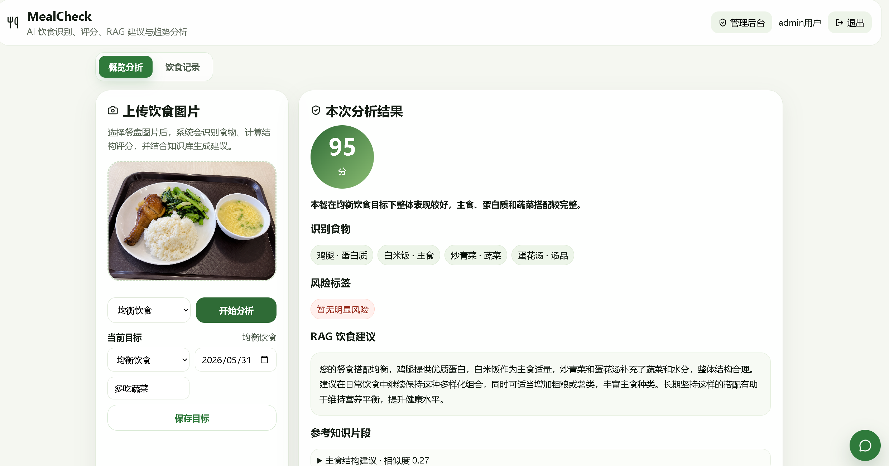
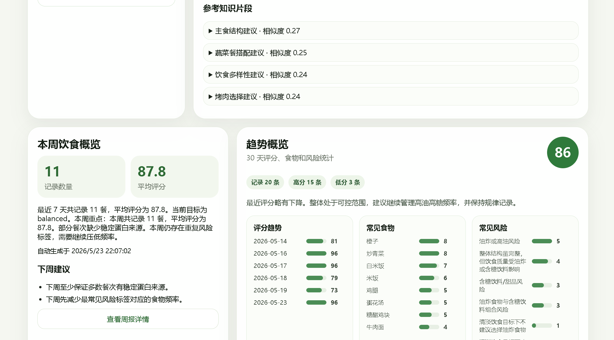
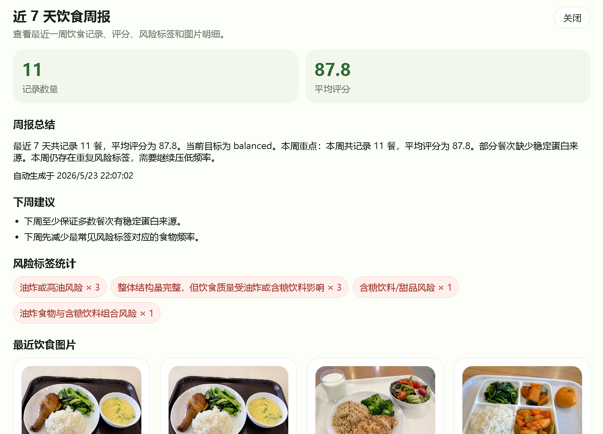

### admin

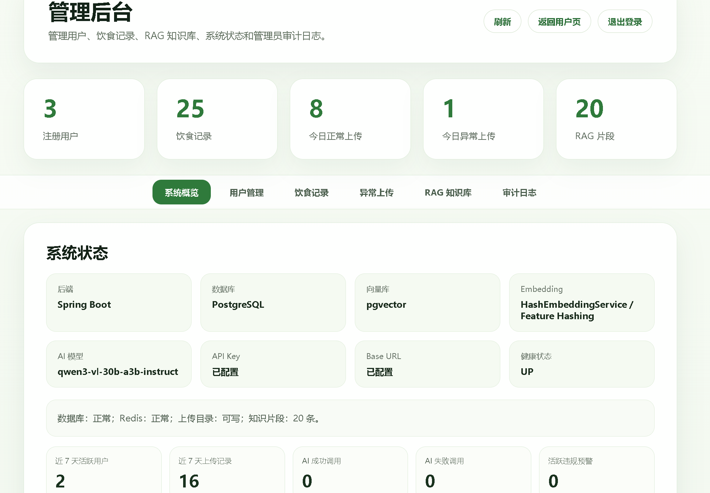
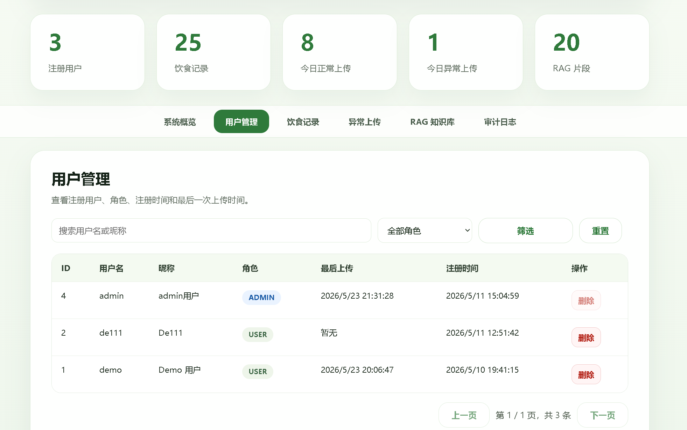
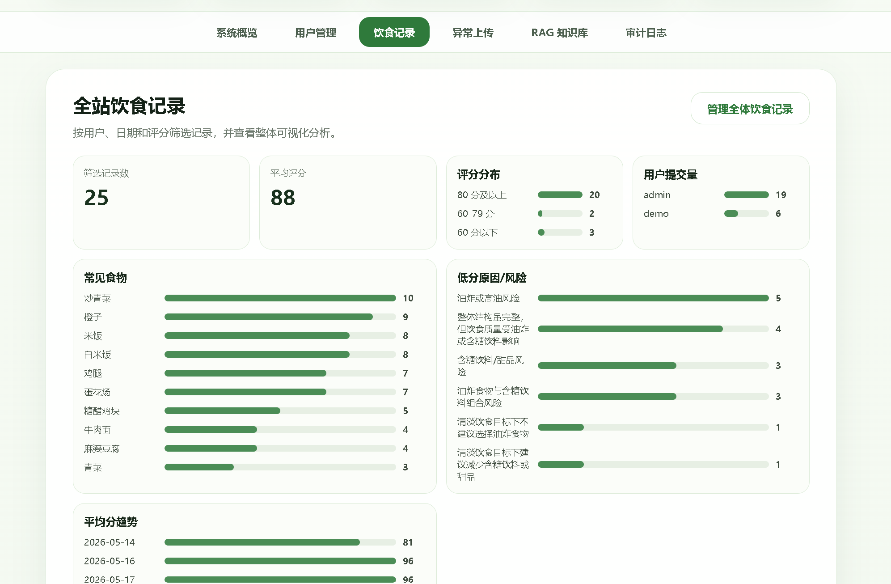
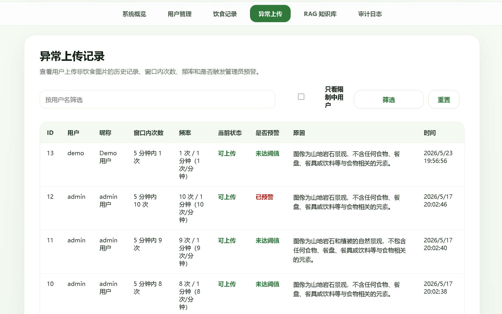
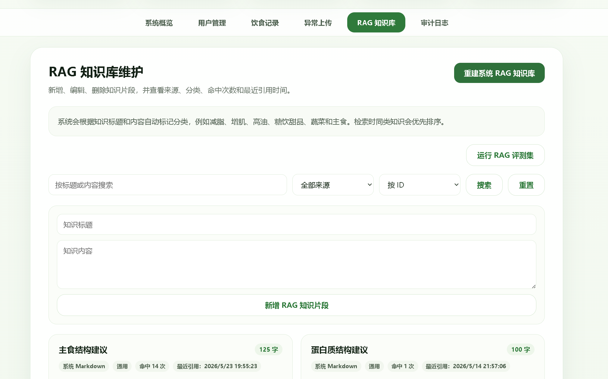
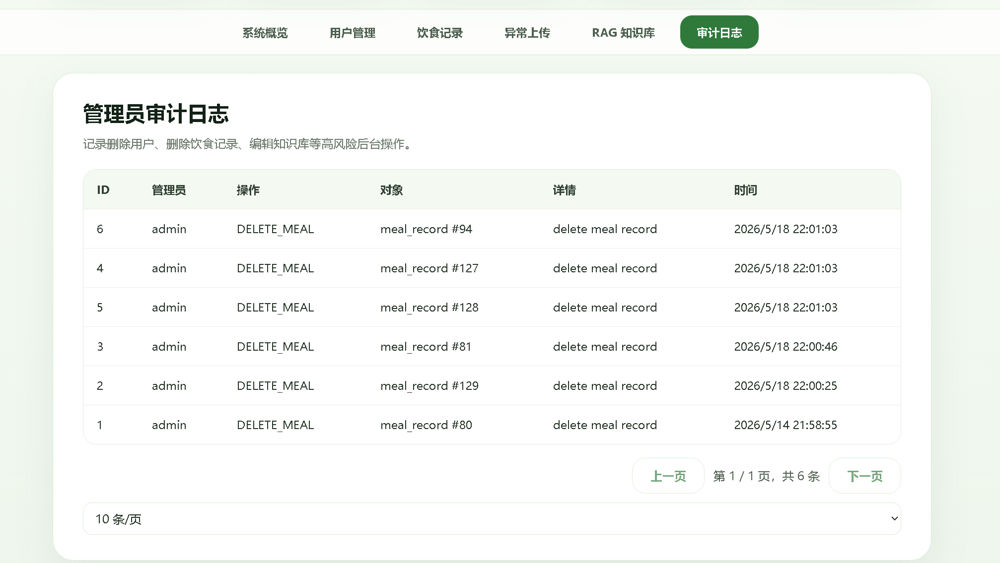

### assistant

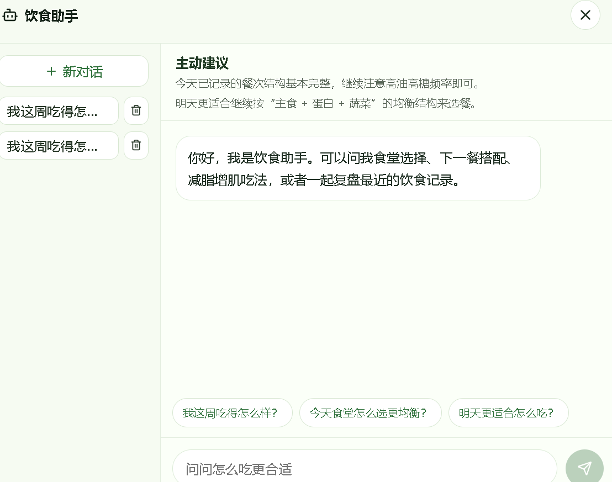
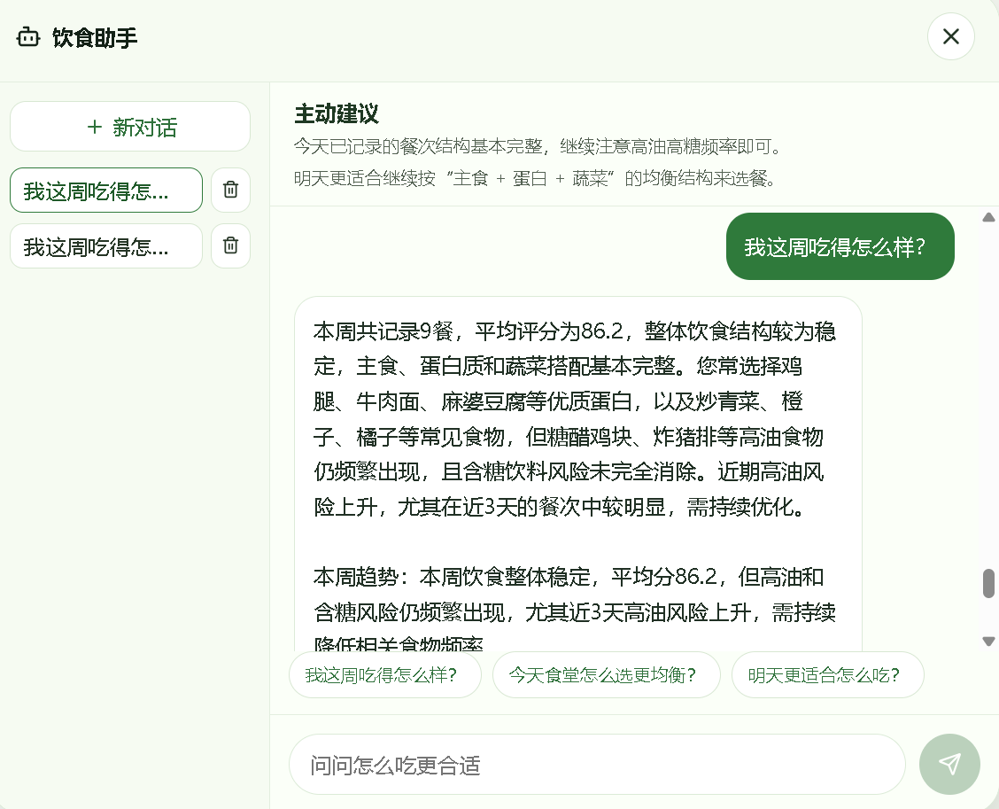
